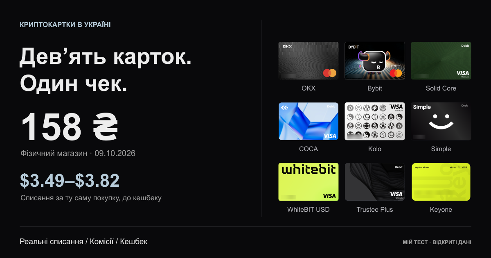

# Дев’ять криптокарток. Один чек на 158 ₴.

**Скільки насправді коштує витрачати крипту в Україні?**

Я оплатив однакову покупку дев’ятьма картками в одному фізичному магазині протягом кількох хвилин. За той самий чек списання склали **$3.49–$3.82 до кешбеку**. Зібрав докази, розібрав поповнення й виведення та порівняв вигоду для гривневих покупок і закордонних підписок.

### [Відкрити дослідження →](https://0k-lab.github.io/crypto-card-for-ukraine-research/)

[Українською](https://0k-lab.github.io/crypto-card-for-ukraine-research/) · [Read in English](https://0k-lab.github.io/crypto-card-for-ukraine-research/en/) · [Методологія](docs/methodology.md)

[](https://0k-lab.github.io/crypto-card-for-ukraine-research/)

## Що порівнюю

**OKX · Bybit · COCA · Kolo · Solid · Simple · Keyone · Trustee Plus · WhiteBIT**

- Реальне списання за однакову гривневу покупку та окремі USD-платежі.
- Кешбек: показану суму, базовий і наступний tier, caps та умови при $1 000/міс.
- Поповнення й виведення: отриману суму, комісії, конвертацію та мережевий gas.
- Дохід на залишок і мій досвід користування, включно з відмовами платежів.

На сторінці можна сортувати картки за списанням, потенціалом кешбеку та вартістю після врахованого кешбеку. Біля висновків доступні очищені скріншоти й пояснення розрахунків.

## На чому ґрунтуються висновки

Тест покупки — **9 жовтня 2026 року**, останнє оновлення — **11 жовтня**. У публічному наборі **124 доказові скріншоти**. Виміряні результати відділяю від заявлених умов, власного досвіду й розрахункових моделей. Невідомі витрати не прирівнюю до нуля; показаний кешбек не завжди вже доступний для витрат.

Це результат мого використання конкретних карток і програм. Один чек не доводить сталість курсу, тарифи для будь-якої суми чи доступність випуску для всіх користувачів.

[Джерела](docs/sources.md) · [Що ще не підтверджено](docs/data-needed.md) · [Приватність доказів](docs/privacy.md)

## Дані та відтворення

| Папка | Що всередині |
| --- | --- |
| `data/` | Вимірювання, джерела, умови й результати розрахунків |
| `locales/` | Українські та англійські тексти |
| `screenshots/` | Очищені доказові PNG |
| `assets/` | Зображення карток, прев’ю та сортування |
| `scripts/` | Спільний шаблон, збірка й перевірки |
| `docs/` | Методологія та документація |

Python 3.12 потрібен для збірки й перевірок, Node.js — для перевірки сортування. Додаткових пакетів немає. Готовий сайт працює як статична сторінка.

```sh
python3 scripts/build.py
python3 scripts/check.py
node scripts/check-sort.cjs
```

Числа й докази редагую в `data/`, тексти — у `locales/uk.json` та `locales/en.json`, оформлення — у `scripts/report-template.html`. Авторство, адресу сайту й дату оновлення зберігаю в `data/research.json`. Після змін перебудовую й перевіряю обидві мовні версії. Для продовження експерименту є [шаблон нового тесту](docs/test-template.md).

## Публікація

У **Settings → Pages → Source** обираю **GitHub Actions**. Підготовлений workflow збирає й перевіряє сайт після push у `main` або ручного запуску. [Повна інструкція та підключення пошуку](docs/github-pages.md).

Для обох мов підготовлені метадані, canonical, hreflang, sitemap і структуровані дані про дослідження.

На сторінці є мої реферальні посилання; бонуси за реєстрацію не впливають на рейтинг.

Власні текст, дані та код — [MIT](LICENSE). Інтерфейси й логотипи належать відповідним правовласникам. [Деталі ліцензування](docs/licensing.md).
